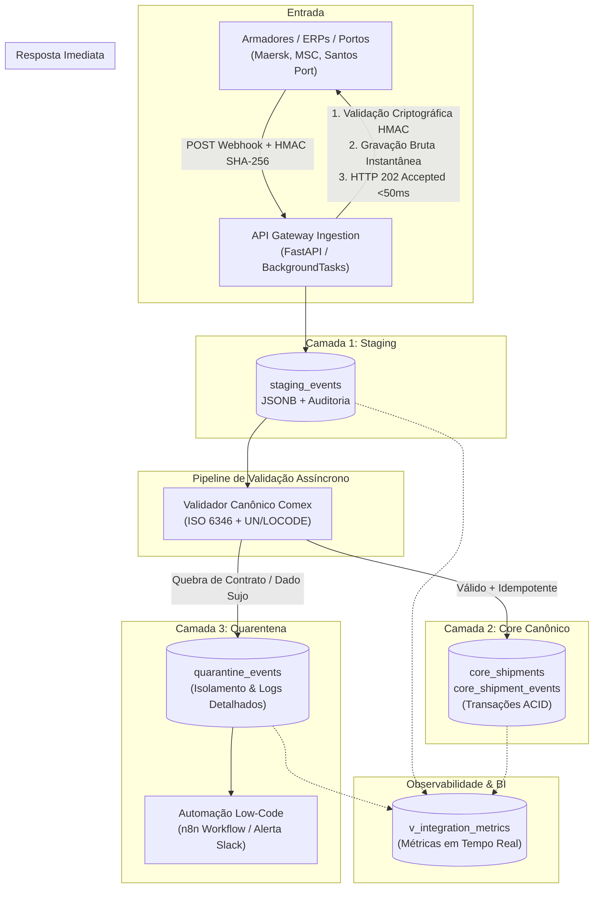

# 🚢 FlowSync: Resilient Comex Data Ingestion & Integration Engine

> **Motor de Ingestão e Integração Resiliente para Comércio Exterior & Logística Internacional.**  
> Projetado com foco em alta disponibilidade, tolerância a falhas, contratos estritos e observabilidade contínua.

[]()
[]()
[]()
[]()

---

## 🎯 1. O Problema Real de Integração em Comex

No comércio exterior e logística marítima/aérea, a ingestão de dados de armadores (Maersk, MSC, Hapag-Lloyd), despachantes aduaneiros e ERPs corporativos enfrenta **4 gargalos crônicos**:

1. **Webhooks Bloqueantes:** Emissores de webhooks exigem resposta `200 OK` em milissegundos. Se a API realizar validações complexas e operações pesadas de banco no mesmo ciclo HTTP, a conexão expira (*timeout*), disparando retransmissões em cascata.
2. **Dados Sujos e Heterogêneos:** Planilhas e APIs externas frequentemente enviam números de contêineres malformados, portos inexistentes e datas caóticas. Fazer `INSERT` direto corrompe o banco operacional.
3. **Falta de Idempotência:** Oscilações de rede em navios e portos fazem o mesmo evento de despacho ser transmitido múltiplas vezes, gerando duplicidade de cobranças e movimentações.
4. **Falta de Isolamento de Falhas (Quarentena):** Quando um lote contém um dado inválido, aplicações ingênuas rejeitam todo o lote ou quebram silenciosamente.

---

## 🏗️ 2. Arquitetura em 3 Camadas

O **FlowSync** resolve esses problemas através de um pipeline desacoplado e resiliente:



---

## 🛡️ 3. Os 4 Pilares de Engenharia

### A. Validação de Assinatura HMAC SHA-256
Garante na borda que o webhook é autêntico e não foi violado em trânsito antes de gastar recursos de processamento (`X-Flowls-Signature` com `hmac.compare_digest` para mitigar *timing attacks*).

### B. Contratos Canônicos Rigorosos
* **Padrão ISO 6346:** Validação estrita de numeração de contêineres (4 letras maiúsculas + 7 dígitos numéricos, ex: `MSCU1234567`).
* **Padrão UN/LOCODE:** Validação de portos mundiais cadastrados pela ONU (2 letras de país + 3 caracteres de localidade, ex: `BRSSZ` para Santos, `CNSHA` para Xangai).
* **Incoterms Internacionais:** Suporte formal a `FOB`, `CIF`, `EXW`, `DDP`, etc.

### C. Isolamento em Quarentena sem Falhar a API
Se um parceiro enviar um contêiner malformado ou moeda inexistente, o sistema **NUNCA** devolve HTTP 500 nem descarta a requisição. O registro vai para a tabela `quarantine_events` com o rastreamento exato do erro, permitindo correção e reprocessamento posterior.

### D. Idempotência por Hash Criptográfico
Eventos de rastreamento de navio/porto utilizam uma chave de hash composta `SHA-256(tracking_number + event_code + occurred_at)` com *constraint* de unicidade no PostgreSQL, impedindo duplicidades decorrentes de retransmissões de rede.

---

## 📊 4. Endpoints da API

| Método | Endpoint | Descrição |
| :--- | :--- | :--- |
| `POST` | `/api/v1/webhooks/comex` | Ingestão assíncrona de webhooks com HMAC e resposta em < 50ms. |
| `POST` | `/api/v1/webhooks/comex/sync` | Ingestão síncrona para testes ponta a ponta e auditoria imediata. |
| `GET` | `/api/v1/shipments` | Consulta embarques consolidados na Camada Core com filtros. |
| `GET` | `/api/v1/shipments/{tracking}` | Detalhes de uma remessa específica e seu histórico de eventos. |
| `GET` | `/api/v1/quarantine` | Listagem de anomalias e contratos violados para o time de suporte. |
| `POST` | `/api/v1/quarantine/{id}/resolve` | Marca uma anomalia de quarentena como tratada após correção. |
| `GET` | `/api/v1/metrics` | Métricas agregadas da View SQL (`total_ingested`, `taxa_sucesso`, etc.). |
| `GET` | `/health` | Checagem de saúde da API e conectividade com o PostgreSQL. |

---

## ⚡ 5. Como Executar

### 1. Pré-requisitos
* Docker & Docker Compose
* Python 3.11+

### 2. Subir o Banco de Dados (PostgreSQL 16)
```bash
docker compose up -d
```

### 3. Rodar a Aplicação
```bash
# Ativar o ambiente virtual
source .venv/bin/activate

# Iniciar o servidor com recarga automática
uvicorn app.main:app --host 0.0.0.0 --port 3000 --reload
```

Acesse a documentação interativa OpenAPI/Swagger em:  
👉 **http://localhost:3000/docs**

### 4. Executar a Suíte de Testes Automatizados
```bash
pytest tests/ -v
```

---

## 🤖 6. Automação Low-Code (n8n)
O projeto acompanha um workflow pronto em [`n8n/quarantine_alert_workflow.json`](file:///home/mateus/Projects/flowsync/n8n/quarantine_alert_workflow.json) que:
1. Executa polling periódico a cada 5 minutos na rota `/api/v1/quarantine?resolved=false`.
2. Se detectar contratos rompidos, dispara alertas imediatos no canal de operações (Slack/Discord) contendo o parceiro emissor e os campos divergentes.
